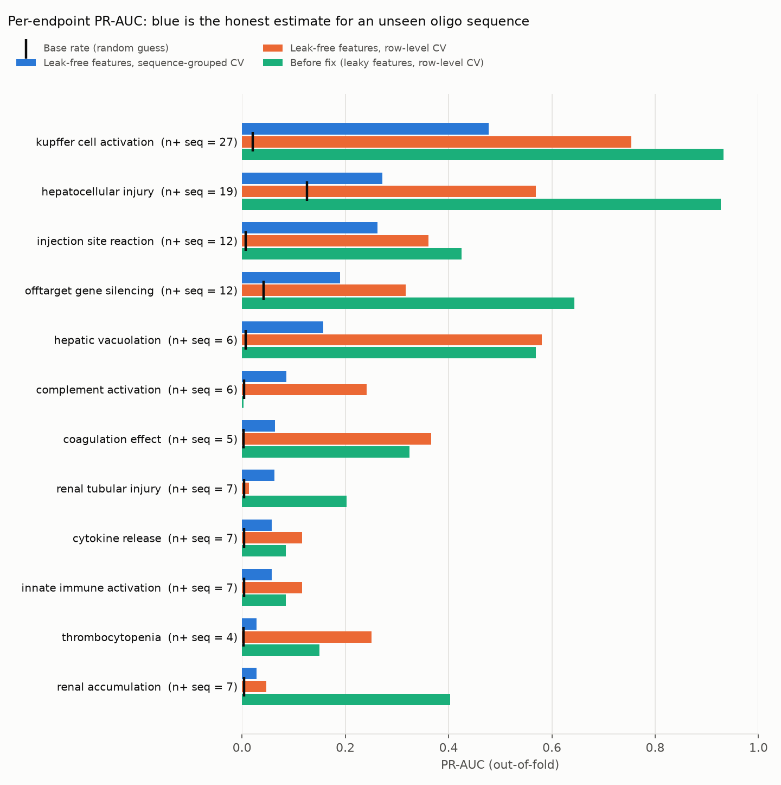
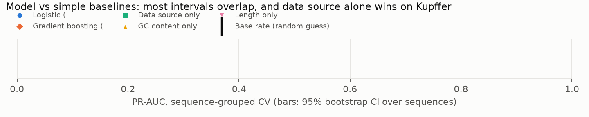
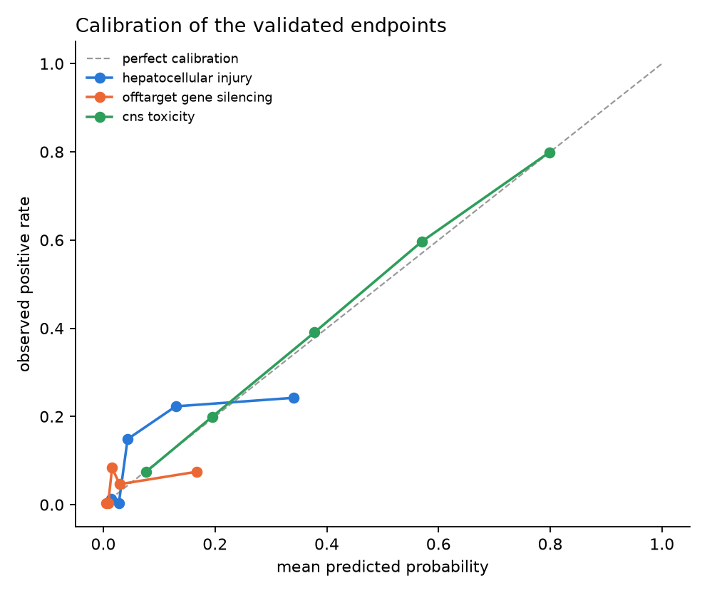

# OligoTox

[](https://github.com/barmanios123/OligoTox/actions/workflows/ci.yml)

OligoTox scores antisense oligos and siRNAs for 13 preclinical toxicity endpoints from design-time features only: sequence, chemistry and modality. It wraps the models in a Streamlit console that adds a GalNAc-siRNA PK/PD simulation and a regulatory-style safety report.

The main result is in the evaluation. The first version scored PR-AUC 0.93 on hepatocellular injury. Most of that came from label leakage and from splitting replicate rows of the same oligo across train and test. After fixing both, the honest number is 0.27 against a 0.13 base rate. Baselines then showed that the one apparently strong endpoint is mostly dataset recognition, not biology. Of the 13 endpoints, 3 now survive that scrutiny, one of them validated on an independent external assay. The app presents only those two as predictions; the rest run but are labelled unsupported, with the reason attached.

## Results



Each bar is an out-of-fold PR-AUC from a calibrated logistic regression. Blue is the number to trust. In that setup, all rows of a sequence (RNA and DNA spellings count as the same sequence) stay on the same side of every split. That matches the real use case: scoring an oligo the model has never seen.

| Endpoint | Positive rows / sequences | Base rate | Before fix | Row-level CV | **Sequence-grouped CV** |
|---|---|---|---|---|---|
| kupffer cell activation | 34 / 27 | 0.021 | 0.93 | 0.73 | **0.48** |
| hepatocellular injury | 203 / 19 | 0.126 | 0.93 | 0.55 | **0.29** |
| injection site reaction | 12 / 12 | 0.007 | 0.42 | 0.36 | **0.27** |
| offtarget gene silencing | 68 / 12 | 0.042 | 0.64 | 0.31 | **0.23** |
| hepatic vacuolation | 12 / 6 | 0.007 | 0.57 | 0.44 | **0.16** |
| complement activation | 6 / 6 | 0.004 | 0.00 | 0.22 | **0.07** |
| coagulation effect | 5 / 5 | 0.003 | 0.32 | 0.36 | **0.07** |
| renal tubular injury | 7 / 7 | 0.004 | 0.20 | 0.01 | **0.06** |
| cytokine release | 7 / 7 | 0.004 | 0.09 | 0.12 | **0.06** |
| innate immune activation | 7 / 7 | 0.004 | 0.09 | 0.12 | **0.06** |
| thrombocytopenia | 4 / 4 | 0.003 | 0.15 | 0.25 | **0.02** |
| renal accumulation | 7 / 7 | 0.004 | 0.40 | 0.05 | **0.02** |

CNS toxicity has only 2 positives in this data and is not evaluated here; it is trained and validated separately on external assays, below. 1,614 rows cover 74 unique sequences.

### What the fix changed

- **Removed outcome columns from the features.** 23 `label_*` / `endpoint_*` columns were curated annotations of the outcome; `label_kupffer_activation` correlated 0.98 with its own target. Two assay readouts (`cas_avg`, `kd_avg`) were also removed, because they are measured after dosing and don't exist for a new design. 111 constant columns were dropped. 39 features remain.
- **Grouped CV by sequence.** Many rows are replicate measurements of the same oligo, so row-level folds leak. Folds now come from `StratifiedGroupKFold` on the normalized sequence.
- **Recomputed features from sequence.** `tlr7_score`, `ps_x_len`, `lna_x_gc`, `seed_gc` and `cpg_density` had been filled inconsistently across the source datasets, and were zero in about half the rows. They are now derived from the sequence for every training row, the same way the app derives them at scoring time. The shipped models were retrained on the recomputed features, so these numbers differ slightly from the first post-leakage run.
- **Reported with the base rate.** For endpoints with fewer than 10 positive sequences, PR-AUC is noisy. Read the gap to the base rate, not the absolute value.

### The hash embedding, removed

16 of the original 55 features were `embed_stub_hash_rna_00..15`, a sha256 of the sequence. The strategy roadmap described the platform as having three RNA foundation models integrated; what actually reached the models was this hash.

`scripts/ablate_hash_embedding.py` scored every evaluated endpoint with and without the block on the same sequence-grouped folds. Removing it improved **9 of 12** endpoints, mean +0.009 PR-AUC, and off-target gene silencing by **+0.073**. Training now drops the block, leaving 39 features.

The consequence is not cosmetic: off-target gene silencing moved from `weak` to `validated` once the hash features stopped masking it. Hepatocellular injury went from 0.27 to 0.29.

## Baselines



A PR-AUC above the base rate is not evidence that the model learned design chemistry. It could be learning which dataset a row came from, or one crude number like GC content. `scripts/evaluate_baselines.py` scores four baselines against the shipped model on the same sequence-grouped folds, with 95% bootstrap CIs resampled over sequences. The **data source only** baseline sees nothing but which dataset a row came from.

| Endpoint | Base rate | Logistic (39 features) | Gradient boosting | GC only | Length only | Data source only |
|---|---|---|---|---|---|---|
| kupffer cell activation | 0.021 | 0.48 [0.32-0.70] | 0.41 [0.29-0.60] | 0.07 | 0.14 | **0.69 [0.53-0.87]** |
| hepatocellular injury | 0.126 | 0.29 [0.21-0.56] | 0.45 [0.26-0.63] | 0.15 | 0.11 | 0.20 [0.10-0.35] |
| injection site reaction | 0.007 | 0.27 [0.07-0.49] | 0.11 | 0.03 | 0.20 | 0.01 |
| offtarget gene silencing | 0.042 | 0.23 [0.07-0.65] | 0.45 | 0.06 | 0.04 | 0.06 |
| hepatic vacuolation | 0.007 | 0.16 [0.04-0.34] | 0.15 | 0.01 | 0.02 | 0.20 [0.06-0.42] |

All 12 evaluated endpoints are in [`reports/results/baselines.csv`](reports/results/baselines.csv); the within-source comparison is in [`reports/results/within_source.csv`](reports/results/within_source.csv).

### How to read it

- **Why a source indicator predicts anything at all.** 1,572 of the 1,614 rows come from two systematic sources (`oligotox_main`, `papargyri_2020`); the remaining 42 are single rows hand-curated from individual papers and FDA labels. Those 42 exist *because* someone published a toxicity finding about them, so 36 of 42 carry a positive label, against 214 of 1,572 in the systematic sources. "Which source is this row from" is therefore close to the label itself, by construction. That is the selection bias the source-only baseline measures.
- **Kupffer cell activation is a dataset artifact, not a finding.** It has the highest grouped PR-AUC (0.48), but the data-source-only baseline beats it (0.69) and the two CIs overlap. All 34 positive rows (27 sequences) sit in that 42-row curated bucket and none in the two systematic sources, and its base rate there is 0.81. Scored inside that source alone the model gets 0.79, below its own base rate, and GC content alone scores higher (0.87). The model is recognising which dataset a row came from. Do not read this endpoint as a toxicity signal.
- **Hepatocellular injury is the most defensible endpoint.** The 39-feature model (0.27) and gradient boosting (0.37) both clear the data-source baseline (0.20) and the GC-only and length-only baselines, and the signal survives within a single source: inside `papargyri_2020` alone the model gets 0.34 against a 0.25 base rate. It is a modest signal, roughly 2.2× the base rate, on 19 positive sequences.
- **Off-target gene silencing** clears its source-only baseline (0.23 against 0.06) and both simple baselines, on 12 positive sequences. It only emerged once the hash features were removed, and its CI is wide, so treat it as the weakest of the three validated endpoints.
- **Injection site reaction** clears its source-only baseline but not the length-only baseline, so it stays weak and unconfirmed.
- **Endpoints with 4–7 positive sequences** are not reliable estimates, and several are beaten by the length-only baseline. Treat them as placeholders until more labeled data arrives.
- **Gradient boosting matches or beats the shipped logistic model** on several endpoints, but every CI overlaps. With 74 sequences there is no evidence to prefer either, so the shipped model stays the simpler, calibrated one.

## What the app will and won't tell you

The evaluation above is enforced in the app, not just described here. `scripts/derive_evidence_tiers.py` turns `baselines.csv` into `artifacts/config/endpoint_evidence.json`, which the scoring pipeline and the report read at runtime. Each endpoint lands in one tier:

| Tier | Endpoints | How the app presents it |
|---|---|---|
| **Validated** | hepatocellular injury, off-target gene silencing, CNS neurotoxicity | A prediction. Enters the composite score. |
| **Weak signal** | injection site reaction | Model output shown with its CI and the baseline it fails to clear. Not a prediction. |
| **Source-confounded** | kupffer cell activation | Model output shown, labelled as dataset recognition. Not a prediction. |
| **Insufficient data** | the remaining 8 | Model output shown with its positive-sequence count. Not a prediction. |

The practical consequences:

- **The composite score averages one endpoint, not 13,** and the tab says so ("Composite covers 1 of 13 endpoints"). Previously it was a severity-weighted mean over all 13, so eleven unsupported models diluted the one that works. On a test candidate the old composite named *renal tubular injury* — 7 positive sequences, beaten by a length-only baseline — as the dominant endpoint.
- **Unsupported endpoints never return `predicted_positive`.** They return `null` with an `evidence_tier` and a plain-English `evidence_note` saying which baseline beat them.
- **The report states what its own evidence supports.** Every JSON report carries a `conclusions` block naming the evidence standard, what the report supports (relative ranking on the endpoints that met it), and what it does not: an absolute probability of toxicity, a clinical outcome or dose, or a substitute for in vivo toxicology. A report with no validated endpoint supports nothing and says so.
- **The regulatory report raises no recommendation from an unsupported endpoint,** whatever it scores. It used to emit "Immunogenicity assessment required per OSWG guidelines" from a complement-activation model fit on 6 positive sequences. A report with no validated endpoint is classified `UNCLASSIFIED_NO_VALIDATED_ENDPOINT` rather than `LOW_RISK`.

Nothing is hidden: every model output is still shown and still in the downloadable JSON. The tier decides whether it is labelled a prediction.

## CNS neurotoxicity, validated on an independent assay

Every other number here is internal: one curation, cross-validated. CNS neurotoxicity is different, and it is the strongest result in the project.

Two public datasets measure it on sequences this repo never trained on, and they share no sequences with each other:

| Dataset | Sequences | Assay | Readout |
|---|---|---|---|
| `MOE_Neurotox_2024` | 1,685 | in vivo | FOB score at 3h |
| `Hagedorn_2022` | 1,653 | in vitro | calcium oscillation, LNA gapmers |

Training on one and testing on the other is a real external test, across different chemistry, different assays and different in vivo/in vitro settings.

| Direction | All sequence features | G-count rule | GC only |
|---|---|---|---|
| MOE to Hagedorn | 0.828 [0.808-0.847] | **0.839** | 0.717 |
| Hagedorn to MOE | 0.783 [0.761-0.803] | **0.797** | 0.628 |

ROC-AUC with 95% bootstrap CIs. Both directions clear chance comfortably, so the signal is real and it transfers.

**The honest caveat: the model does not beat the published rule.** Hagedorn et al. report that G count and the distance from the 3' end to the nearest G drive acute neurotoxicity. Those four features alone score the same or slightly better than the full feature set in both directions. So this endpoint is best read as a reimplementation of their rule, validated on an independent assay, rather than a new finding. The evidence config says so in the text the app displays.

The shipped `cns_toxicity` model is trained on all 3,338 sequences and uses sequence-derived features only, since the external data carries no chemistry annotation, so it has its own column list in `artifacts/config/endpoint_features.json`. It replaces a model fit on **2 positive sequences** that training had marked `fallback_low_count_fit`.

### A label direction worth flagging

Hagedorn's readout is calcium oscillation, and toxicity shows up as a **reduction** in it, so a low score means toxic. `data/oligogym/oligogym_tox_combined_fixed.csv` has this inverted: it labels high scores as toxic and ends up calling 83% of the compounds neurotoxic. The threshold used here is stated in `scripts/evaluate_cns_external.py` and swept over five values, and the result holds across all of them (MOE 0.81 at every cut-off, Hagedorn 0.90 at the strictest).

### External data ingestion

`scripts/normalize_external_tox.py` is the single entry point for the datasets in `data/oligogym/`. It exists because the pre-existing combined files could not be checked: one has a `y_binary` column holding rounded raw readouts, and the other is binary but has Hagedorn's direction inverted. Neither records a threshold or a direction.

Every readout's direction, threshold and citation is declared in one table in that script, and a dataset missing from it is an error rather than a silent default. It also separates the three potency datasets (McQuisten, Ichihara x2, 6,718 sequences) from the three toxicity ones, because a target-inhibition readout sitting in a file named `tox_combined` is how a potency number ends up trained as a safety label.

```bash
python scripts/normalize_external_tox.py
```

Writes `external_tox_normalized.csv`, `external_efficacy_normalized.csv` and a manifest recording every labelling decision. Tests assert the direction of each source and that no efficacy readout carries a toxic label.

## Efficacy, back with evidence behind it

The Efficacy tab was removed in an earlier pass because it held untrained model slots whose outputs were not predictions. It is back, trained on 6,718 potency sequences that were sitting unused in `data/oligogym`.

Potency has its own shortcut. It varies far more between target genes than within one, so a model that has seen other oligos against the same gene can score well while knowing nothing about design. Two guards: folds are grouped by target gene, and a target-gene-mean baseline that ignores the sequence entirely is scored alongside.

| Model | Data | Gene-grouped CV | Cross-study | GC only | Gene mean | Tier |
|---|---|---|---|---|---|---|
| siRNA potency | 2,838 duplexes, 41 genes | **0.57** [0.54-0.59] | **0.46** / **0.49** | 0.30 | -0.11 | validated |
| ASO activity | 3,867 PS-ASOs, 85 genes | **0.26** [0.23-0.29] | none available | 0.14 | -0.15 | weak |

Spearman between measured potency and out-of-fold prediction, using position-specific features (nucleotide identity at positions 1, 10 and the 3' end, seed AU content and duplex-end stability) alongside composition. Adding them lifted every split, held-out studies included. The siRNA number transfers between two independent studies (Ichihara 1 and 2) that share no sequences, in both directions. The gene-mean baseline carries none of it, and 17-29% of the variance is between genes, which is why the grouping matters.

The tab only scores the modality a model was trained for: ask it about a PMO and it says no model is validated for that, rather than returning a number. Scores are raw readouts in the units of the training data, labelled as such, never probabilities.

**Caveat on the siRNA model:** the training data is 2007 chemistry with no modification annotation, so it scores sequence design only and knows nothing about the chemistry of a modern GalNAc-siRNA.

### A duplex parsing bug this turned up

Ichihara's entries are siRNA duplexes written as one string, `sense.antisense`. Read naively they look like 41-nt "sequences" whose length and GC content are computed over both strands and the separator. The normalizer now splits them and uses the 21-nt antisense guide, which is what drives potency.

### Privacy on the public deployment

Runs live in the visitor's browser session and are never written to the server. An earlier version saved every run to `artifacts/runs/` and the Saved runs tab listed every file it found there, which on a shared container means one visitor's sequences are readable by the next. Download a run to keep it.

## Calibration, reported separately from ranking

PR-AUC says whether a model ranks. It says nothing about whether 0.30 means a three-in-ten chance. For a safety tool those come apart, so `scripts/evaluate_calibration.py` reports both on the same out-of-fold predictions.

| Endpoint | Tier | Observed rate | Mean predicted | Brier skill | Calibration MAE |
|---|---|---|---|---|---|
| cns toxicity | validated | 0.412 | 0.404 | **+0.30** | 0.009 |
| offtarget gene silencing | validated | 0.042 | 0.045 | +0.03 | 0.037 |
| hepatocellular injury | validated | 0.126 | 0.111 | **-0.01** | 0.066 |
| injection site reaction | weak | 0.007 | 0.029 | -2.37 | 0.021 |

Brier skill is `1 - brier/brier_base_rate`; at or below zero means the probabilities are no better than quoting the base rate.

**The finding that matters: hepatocellular injury ranks but does not calibrate.** It beats every baseline on PR-AUC and its signal survives a within-source check, yet its Brier skill is slightly negative. Read its score as a ranking, not a percentage. CNS neurotoxicity is the one endpoint whose probabilities are trustworthy as probabilities, which is unsurprising given it has 3,338 training sequences against 74.

Most unsupported endpoints over-predict badly, injection site reaction by about four times its base rate, which is a second reason not to read them as predictions. Every endpoint's `probabilities_calibrated` flag and Brier skill is in `artifacts/config/endpoint_evidence.json`, and the app shows a "reads as" column saying *probability* or *ranking only*.



### Do richer representations help? No.

The strategy roadmap lists three RNA foundation models under "what we have". Nothing called them, and what reached the models was the hash stub. With 3,338 CNS sequences and a cross-assay split, the question is finally testable: `scripts/evaluate_sequence_representations.py`.

| Representation | Features | MOE to Hagedorn | Hagedorn to MOE |
|---|---|---|---|
| **Hand features** | 17 | **0.828** [0.808-0.847] | **0.783** [0.761-0.804] |
| 3-mer counts | 64 | 0.791 | 0.772 |
| 3-mer + 4-mer | 320 | 0.792 | 0.767 |
| k-mer + hand | 337 | 0.827 | 0.779 |
| Hash stub (control) | 16 | 0.506 | 0.507 |

Seventeen hand-designed features beat 320 k-mer features in both directions, and adding k-mers to them changes nothing. Sequence content past what the design features already capture does not carry CNS neurotoxicity here. The hash control lands on 0.506, exactly chance, which is both a sanity check on the setup and confirmation that removing it was right.

Pretrained RNA language model embeddings are not evaluated, because no weights are available in this environment; downloading them is a prerequisite, not a result. But the k-mer arms test the thing those embeddings are meant to supply, and it is not what is limiting this endpoint. The roadmap's claim that foundation models are integrated remains untrue, and on this evidence acting on it is not the highest-value next step.

### Hepatocellular injury does not transfer

The one public set pairing gapmer sequences with liver enzymes is the hepatotoxicity screen in [NAR 2022;50(13):7224](https://doi.org/10.1093/nar/gkac562), Supplementary Table S1: 149 LNA gapmers, C57BL/6 mice at 20 mg/kg IV, AST/ALT at 96 h. `scripts/evaluate_hepatotox_external.py` parses it and scores every sequence with the shipped model.

| | Value |
|---|---|
| Sequences | 149 |
| Hepatotoxic (ALT > 100 U/L) | 5 |
| ROC-AUC | **0.40** [0.13-0.70] |
| PR-AUC | 0.035, against a 0.034 base rate |
| Rank of the toxic sequences | 23, 76, 87, 120, 139 of 149 |

**The model ranks the known-hepatotoxic gapmers no better than chance, and three of the five sit in the bottom half.** With 5 positives the interval spans almost everything, so this does not prove the model is wrong. What it does mean is that there is no evidence the endpoint transfers off its own source, and that sits alongside its negative Brier skill.

Read together: hepatocellular injury ranks within `papargyri_2020`, does not produce calibrated probabilities, and shows no transfer to an independent screen of a different chemistry. It keeps its tier, because the tier reflects the internal evaluation and 5 positives should not overturn that either way, but the evidence string the app displays now carries this result.

This is also the clearest statement of what the project needs: not more features, but hepatotoxicity data at the scale the CNS endpoint has.

## The evaluation is the product

The models here are not better than PFRED, ASOptimizer or any proprietary platform, and with 74 unique sequences they will not be. What this repo has instead is a harness that says, per endpoint, whether a result survives scrutiny, and an app that refuses to present anything that does not.

| Check | Script | Catches |
|---|---|---|
| Leakage | `src/oligotox/training/train.py` | Curated annotations and post-dose readouts used as features |
| Grouped splits | same | Replicate rows of one sequence spanning a split |
| Source baseline | `scripts/evaluate_baselines.py` | A model reading which dataset a row came from |
| Ablation | `scripts/ablate_hash_embedding.py` | Feature blocks that carry nothing |
| Representation | `scripts/evaluate_sequence_representations.py` | Whether a richer encoder would help |
| Calibration | `scripts/evaluate_calibration.py` | Scores that rank but are not probabilities |
| External transfer | `scripts/evaluate_cns_external.py`, `evaluate_hepatotox_external.py` | Internal validity that does not generalise |
| Gating | `scripts/derive_evidence_tiers.py` | Any of the above reaching the user as a prediction |

The checks are modality-agnostic, and packaged to run on anyone's data:

```bash
python -m oligotox.audit their_data.csv --label hepatotox --sequence seq --source study
```

It needs a feature matrix, a label column, a sequence column to group on and optionally a source column, and it imports nothing else from this project. It exits non-zero when an endpoint fails a check, so it can gate a pipeline. Run blind against this repo's own training data it reproduces, unprompted, the three conclusions that took this project months to reach:

```
               endpoint                verdict  groups  pos_groups  grouped  ungrouped  source_only  brier_skill
  hepatocellular_injury ranks but uncalibrated      74          19    0.274      0.551        0.201       -0.009
kupffer_cell_activation      source confounded      74          27    0.477      0.782        0.827        0.344
       thrombocytopenia      insufficient data      74           4    0.048      0.297        0.003        0.003
```

Each verdict comes with its reasoning, for example *"a model seeing only the source scores 0.83 against 0.48; the model is recognising the dataset"*. Each result lands in `artifacts/config/endpoint_evidence.json`, which the app and the OSWG report read at runtime, so a failed check becomes a label in the interface rather than a footnote.

**[`docs/NEGATIVE_RESULTS.md`](docs/NEGATIVE_RESULTS.md)** records the nine failure modes this found, with numbers and the script for each. **[`docs/DATA_REQUESTS.md`](docs/DATA_REQUESTS.md)** lists what the platform is actually limited by, which is labelled data rather than method.

## Run it

```bash
git clone https://github.com/barmanios123/OligoTox.git
cd OligoTox
python -m venv .venv && source .venv/bin/activate
pip install -r requirements.txt && pip install -e . --no-deps
streamlit run oligotox_app.py
```

The trained models and their config ship in `artifacts/`, so the app scores candidates from a fresh clone without the training data. The app, the tests and CI need no deep learning stack; `torch` is an optional extra (`pip install -e ".[efficacy]"`) used only by unshipped experiments.

### Tests

```bash
pip install pytest
pytest -q
```

The suite checks that leaky columns can't re-enter training, that published metrics are sequence-grouped, that app-time features match the trained columns, that the baseline results cover every evaluated endpoint with valid CIs, and that the app completes a full run headlessly. It also re-derives every evidence tier from `baselines.csv` and asserts the shipped config agrees, so the tiers can't drift from the evaluation; that the predictions table lists only validated endpoints; and that an unsupported endpoint scoring 1.0 raises no regulatory recommendation. CI runs it on every push.

## Reproducing the numbers

The data every published number is computed from is in the repo, so the evaluation is checkable rather than claimed. Four files, 1.2 MB total: `feature_matrix.csv` (1,614 x 39), `label_matrix.csv`, `training_dataset.csv` (sequences, source and curated labels) and `dataset_metadata.json`. Every source in them is public literature, a PMID/PMC paper or an FDA label; the other contents of `data/processed/` are intermediates and stay out.

From a fresh clone, training takes about 10 seconds and the baselines about 95 seconds:

```bash
python -m oligotox.training.train       # retrains all 13 endpoint models
python scripts/evaluate_baselines.py    # recomputes baselines and bootstrap CIs
```

Verified in a clean clone of this commit: all 13 per-endpoint PR-AUCs reproduce to the published figure exactly, `baselines.csv` and `within_source.csv` reproduce with zero difference across all 60 and 36 rows, `endpoint_evidence.json` comes out byte-identical, and so do all 13 shipped `.joblib` models. The models in `artifacts/` are the ones this data and this script produce.

### Retrain and regenerate the figures

```bash
python -m oligotox.training.train
cp artifacts/metrics/training_summary.json reports/results/training_summary_after.json
python scripts/make_results_figure.py
python scripts/evaluate_baselines.py     # writes baselines.csv and within_source.csv
python scripts/make_baselines_figure.py  # writes baselines.png
python scripts/derive_evidence_tiers.py  # writes artifacts/config/endpoint_evidence.json
```

The last step is what the app reads, so rerun it after any change to the baselines, or the tier test will fail.

## What's in the app

| Tab | What it does | Status |
|---|---|---|
| Candidate Input | Sequence, chemistry, modality and dose entry, with validation | — |
| Toxicity Results | Predictions for the validated endpoints, a composite over those only, and the remaining model outputs behind an expander with the reason each is excluded | Gated by evidence tier |
| PK/PD | Liver AUC, Cmax and half-life from a GalNAc-siRNA compartment simulator | Mechanistic simulator, not fitted to this data |
| Regulatory Report | OSWG-style JSON safety summary, with an evidence block and recommendations raised only from validated endpoints | Report formatting |
| Efficacy | Potency for the candidate's modality, with its units, evidence and caveat | siRNA validated, ASO weak |
| Saved Runs | Runs kept during the session | — |
| Build Info | Model versions, feature count and config provenance | — |

The Efficacy tab previously held untrained model slots and was removed rather than shipped behind a disclaimer. It returned once the models were trained and validated against baselines.

## Limitations

- 74 unique sequences is small. Nine of the 13 endpoints have 7 or fewer positive sequences.
- **Only 3 of the 13 endpoints are presented as predictions.** Hepatocellular injury survives both the data-source baseline and a within-source check; Kupffer cell activation, the highest raw score, does not. CNS neurotoxicity is validated on external data but reproduces a published rule rather than improving on it. The other 10 models ship and run, but the app labels them unsupported.
- Hepatocellular injury rests on 19 positive sequences with within-source confirmation from a single dataset. A second independent source is what would settle it, and no external hepatotoxicity data is on hand.
- Several endpoints draw all their positives from one source dataset, so source and biology cannot be separated for them with this data.
- The structure features use a placeholder MFE. The hash 'sequence embedding' was removed after an ablation showed it helped nothing; no learned sequence model has replaced it.
- The PK/PD simulator is mechanistic and has not been fitted or validated against measured exposure data.

## Repository layout

```
oligotox_app.py          Streamlit console
src/oligotox/            package: features, training, scoring, PK/PD, reporting
artifacts/models|config  shipped trained models, scoring config, evidence tiers
reports/results/         metrics, baselines and the figures
scripts/                 results figure, baseline evaluation, tier derivation
tests/                   pytest suite (run in CI)
benchmarks/oligogym/     leakage-aware benchmark scripts
docs/                    architecture and provenance notes
```

## License

MIT; see `LICENSE`.

The curated datasets under `data/` are derived from published literature, PMC articles and FDA labels, each credited in `docs/provenance/DATA_AND_MODEL_PROVENANCE.md`. The MIT grant covers this repository's own code and curation; the underlying publications keep their own terms, so cite the original sources rather than this repo when using the data.
